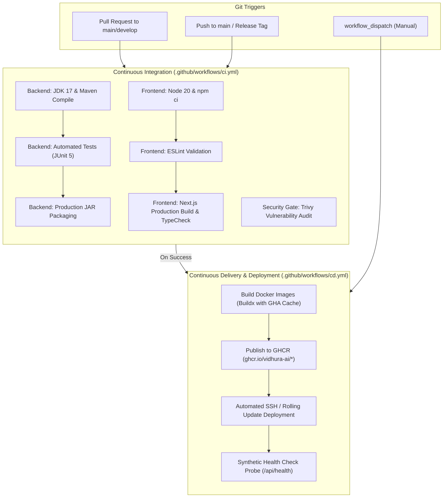

# Vidhura AI — Enterprise CI/CD Pipeline Documentation

This document outlines the Continuous Integration (CI) and Continuous Delivery/Deployment (CD) architecture implemented for Vidhura AI.

---

## 1. Pipeline Architecture Overview

The pipeline employs a modern, multi-stage GitOps workflow utilizing **GitHub Actions**, **GitHub Container Registry (GHCR)**, **Docker Compose**, and **Synthetic Health Probes**.



---

## 2. Pipeline Stages & Workflows

### A. Continuous Integration (`.github/workflows/ci.yml`)
Runs on every Pull Request and Push to `main` or `develop`.

1. **Backend Quality Gate** (`backend-ci`):
   - **Environment**: Ubuntu Latest, JDK 17 (Eclipse Temurin).
   - **Maven Cache**: Uses `actions/setup-java` Maven dependency caching to reduce build times by ~70%.
   - **Test Execution**: Executes `mvn test -B` strictly. Any test regression breaks the build.
   - **Artifacts**: Uploads Surefire test reports and the packaged JAR (`vidhura-ai-backend-1.0.0.jar`) as downloadable GitHub artifacts.

2. **Frontend Quality Gate** (`frontend-ci`):
   - **Environment**: Ubuntu Latest, Node.js 20 LTS.
   - **Dependency Locking**: Uses `npm ci` referencing `package-lock.json`.
   - **Linting**: Runs ESLint with Next.js Core Web Vitals rules.
   - **Production Compilation**: Runs `npm run build` to enforce TypeScript static typing and Turbopack page optimization across all 17 application routes.

3. **Security Audit Gate** (`security-audit`):
   - Scans the repository filesystem using **Aquasecurity Trivy** for high/critical CVEs and misconfigurations.

---

### B. Continuous Delivery & Deployment (`.github/workflows/cd.yml`)
Runs on Push to `main`, release tags (`v*.*.*`), or via manual `workflow_dispatch`.

1. **Stage 1: Container Build & Push**:
   - Uses `docker/setup-buildx-action` with GitHub Actions cache (`type=gha,mode=max`).
   - Automatically generates multi-tags:
     - `ghcr.io/<owner>/<repo>/backend:latest`
     - `ghcr.io/<owner>/<repo>/backend:<commit-sha>`
     - `ghcr.io/<owner>/<repo>/frontend:latest`
     - `ghcr.io/<owner>/<repo>/frontend:<commit-sha>`
     - Versioned release tags (e.g., `:v1.0.0`) when triggered by a git release tag.

2. **Stage 2: Rolling Deployment**:
   - Connects to the host server via SSH (when `DEPLOY_HOST` is configured).
   - Authenticates to GHCR and executes zero-downtime rolling update:
     ```bash
     docker compose pull
     docker compose up -d --remove-orphans
     docker image prune -af --filter "until=48h"
     ```

3. **Stage 3: Post-Deployment Synthetic Smoke Test**:
   - Automatically polls the live health endpoint:
     ```bash
     curl -f http://<DEPLOY_URL>/api/health
     ```
   - Retries up to 10 times with 10-second intervals.
   - Verifies HTTP 200 and healthy backend payload. If unreachable, fails the deployment step for prompt rollback.

---

## 3. Running CI Checks Locally

Before pushing code or opening a Pull Request, you can run the entire CI validation suite locally in a single command:

### On Windows (PowerShell):
```powershell
.\scripts\ci-check.ps1
```

### On Linux / macOS / Git Bash:
```bash
chmod +x ./scripts/ci-check.sh
./scripts/ci-check.sh
```

Both scripts run:
1. Backend Maven compilation and unit tests.
2. Frontend ESLint validation and Next.js production build.
3. Docker Compose configuration syntax validation.

---

## 4. Required GitHub Secrets Checklist

To activate automated deployment and remote container publishing, configure the following secrets in **GitHub Repository Settings $\rightarrow$ Secrets and variables $\rightarrow$ Actions**:

| Secret Name | Required For | Description | Example / Default |
| :--- | :--- | :--- | :--- |
| `GITHUB_TOKEN` | Automatic | Provided by GitHub Actions for publishing to GHCR | *Auto-injected* |
| `GROQ_API_KEY` | Production Runtime | Groq Llama 3.3 70B API key for AI reasoning | `gsk_...` |
| `JWT_SECRET` | Production Runtime | 256-bit secret key for signing auth tokens | Min 32 characters |
| `DEPLOY_HOST` | Automated CD | Production server IP or hostname | `203.0.113.1` |
| `DEPLOY_USER` | Automated CD | SSH user for deployment | `ubuntu` or `deploy` |
| `DEPLOY_KEY` | Automated CD | Private SSH key authorized on production server | `-----BEGIN OPENSSH...` |
| `DEPLOY_URL` | Post-Deploy Test | Base URL for synthetic health check | `https://vidhura.ai` |
