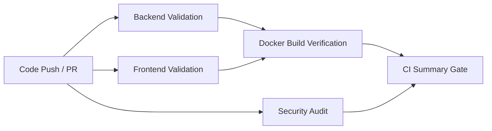

# Vidhura AI — CI/CD Pipeline & Release Governance

## 1. Core Principles

1. **Separation of Concerns:** Continuous Integration (CI) and Continuous Delivery/Deployment (CD) are strictly decoupled.
2. **Immutable Artifacts:** Every CI run builds and tests reproducible artifacts before release consideration.
3. **Release Approval Boundary:** No code pushed to `main` or `version-2` is automatically deployed to production. Production image publication and server deployments require explicit human authorization.
4. **Zero-Secret CI Logs:** All test secrets and dummy keys in CI workflows are synthetic mock values (`ci-dummy-key`, mock JWT tokens); real credentials never touch GitHub Actions logs.

---

## 2. CI Pipeline Stages (`.github/workflows/ci.yml`)

The CI pipeline runs automatically on:
- Pull requests targeting `version-2`, `develop`, or `main`.
- Pushes to branches matching `version-2`, `develop`, `main`, `feature/**`, or `release/**`.
- Manual trigger via `workflow_dispatch`.

### Stage Details

| Stage | Runner | Actions Performed | Gate Criteria |
|---|---|---|---|
| **Backend CI** | `ubuntu-latest` | • JDK 17 Temurin setup • Maven dependency resolution • `mvn clean test-compile` • `mvn test` automated test suite • Publish surefire reports (`upload-artifact@v4`) • `mvn package -DskipTests` (production JAR upload) | All unit and integration tests pass (0 failures, 0 errors). |
| **Frontend CI** | `ubuntu-latest` | • Node.js 20 setup • Deterministic `npm ci` • TypeScript validation (`npx tsc --noEmit`) • Lint validation (`npm run lint`) • Next.js production build (`npm run build`) | Zero TypeScript errors, zero lint errors, build succeeds. |
| **Security Audit** | `ubuntu-latest` | • Trivy filesystem vulnerability scanner • Non-blocking audit scan for CRITICAL/HIGH CVEs | Audit findings surfaced in CI logs. |
| **Docker Validation** | `ubuntu-latest` | • Build backend Dockerfile (`push: false`) • Build frontend Dockerfile (`push: false`) | Both multi-stage images assemble cleanly. |
| **CI Summary** | `ubuntu-latest` | • Evaluates results of all upstream stages | Exits with code 1 if any mandatory gate failed. |

---

## 3. CD Pipeline & Release Authorization (`.github/workflows/cd.yml`)

### Governance & Safety Controls
- **No Automatic Deployment to Main:** Merging a pull request into `main` or `version-2` does **not** trigger container publication or server deployment.
- **Explicit Authorization:** CD can only be triggered via:
  1. `workflow_dispatch` requiring the user to explicitly type `RELEASE_AUTHORIZED` and select the target environment (`staging` or `production`).
  2. Git release tags following semantic versioning (e.g., `v2.0.0`).

### CD Workflow Stages
1. **Authorization Gate:** Evaluates invocation parameters; aborts immediately if confirmation code is absent or incorrect.
2. **Build & Publish:** Authenticates to GitHub Container Registry (`ghcr.io`), builds OCI images, and pushes version-tagged images (`ghcr.io/<org>/vidhura-backend:<tag>`, `ghcr.io/<org>/vidhura-frontend:<tag>`).
3. **Deployment:** Connects via SSH (`DEPLOY_HOST`, `DEPLOY_USER`, `DEPLOY_KEY`) to run `docker compose -f docker-compose.prod.yml pull && docker compose up -d`.
4. **Post-Deployment Smoke Test:** Probes `/api/health` with exponential backoff to ensure service availability.

---

## 4. Release Checklist Before Feature-to-Version-2 Merge

Before merging feature branches into `version-2`:
- [ ] Backend test suite passes locally (`mvn test -Djava.io.tmpdir=E:\temp`).
- [ ] Frontend type check passes (`npx tsc --noEmit` in `frontend`).
- [ ] Frontend production build succeeds (`npm run build` in `frontend`).
- [ ] Git status confirms no untracked secrets, credentials, or policy binaries.
- [ ] CI workflow passes on the pull request targeting `version-2`.
- [ ] Product and regulatory review sign-off obtained.
